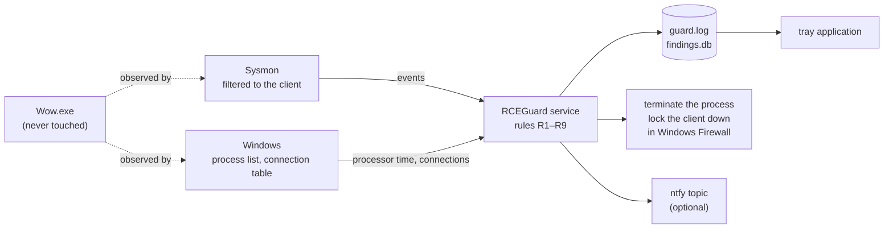

# RCEGuard

**A watchdog for *World of Warcraft* 3.3.5a clients on private servers.** It watches the game
client from the outside and reports behaviour that points to remote code execution: the client
starting a program, talking to an unknown host, writing an autostart entry, opening other
programs, or keeping every processor core busy.


> [!IMPORTANT]
> RCEGuard is experimental and makes no promise to stop an attack. It reacts after the fact
> (about a second after the event), it is not an antivirus, and it does not help against an
> attacker who already has administrator or kernel rights. Read [Status](#status) before you
> rely on anything here.

- **It never touches the game process.** No injection, no hooks, no patching, no memory reading.
  It only uses what Windows offers from the outside: [Sysmon](https://learn.microsoft.com/sysinternals/downloads/sysmon),
  the process list and the connection table of Windows, Windows Firewall and Exploit Protection.
- **It fails loudly.** A guard that cannot read its sensor ends with the reason instead of
  looking healthy.
- **It cleans up after itself.** What `install.ps1` puts on the machine, `uninstall.ps1` removes
  (what stays are the entries the service wrote to the Windows Application log).

## Contents

- [How it works](#how-it-works)
- [What it detects](#what-it-detects)
- [Status](#status)
- [Requirements](#requirements)
- [Quick start](#quick-start)
- [Configuration](#configuration)
- [Tray application](#tray-application)
- [Blocking in advance (optional)](#blocking-in-advance-optional)
- [Notifications to your phone (optional)](#notifications-to-your-phone-optional)
- [Removing it](#removing-it)
- [Patching the client (optional)](#patching-the-client-optional)
- [Privacy](#privacy)
- [Development](#development)
- [Documentation](#documentation)
- [License](#license)

## How it works



1. **Sensor.** Sysmon runs with a configuration that records only what the configured client
   does: programs it starts, connections, files, registry writes, loaded modules, other
   programs it opens.
2. **Service.** `RCEGuard.Service` runs as a Windows service, reads the Sysmon log and judges
   every event with the rules below. While a client runs, it also reads the client's processor
   time and its connections from Windows itself, because Sysmon does not record every
   connection.
3. **Action.** Every finding goes to a log file and a database. Depending on the rule the guard
   also alerts, terminates the started program and the client, and locks the client out of the
   network until someone releases it.
4. **Tray application.** A shield next to the clock shows the state, a window lists the
   findings, and a new finding comes up as a Windows notification.

The details, with what was measured, are in [docs/DETECTION.md](docs/DETECTION.md).

## What it detects

| Rule | Trigger | Severity | Action |
| :--- | :--- | :--- | :--- |
| R1 | the client starts any program | critical | terminate child and client |
| R1 | Windows attaches a console host (`conhost.exe`) to the client | medium | log |
| R2 | connection to an address that is not allowed (loopback is always allowed) | critical | alert; terminate only with `killOnUnknownRemote` |
| R2 | the same while the profile is in learning mode | info | log |
| R3 | program file created anywhere, or any file in a Startup folder | high | alert |
| R3 | other file outside the game folder | medium | log |
| R4 | autostart, Winlogon, debugger hijack or service configuration written | critical | terminate client |
| R4 | such an entry removed / other write below `Services` | medium / info | log |
| R5 | unsigned module loaded from a user-writable folder outside the game folder | high | alert |
| R5 | unsigned module loaded from elsewhere outside the game folder | medium | log |
| R6 | the client starts a thread in another program | critical | terminate client |
| R7 | the client opens another program (not its own child) with rights to change it: write its memory, change its memory protection or start threads in it ("all access" includes that), or with rights that cannot be read | high | alert, also for a program on `allowedProcessAccess` |
| R7 | the client opens another program to read its memory | medium | log; nothing for a program on `allowedProcessAccess` |
| R7 | the client opens another program for less (ask about it, wait for it) | info | log; nothing for a program on `allowedProcessAccess` |
| R8 | a client keeps more than `cpuAlertCores` processor cores busy on average over `cpuAlertSeconds` (1.0 = one core fully busy; `"cpuAlertCores": 0` turns the rule off) | medium | alert, once per stretch of high load |
| R9 | miner-like command line in a child of the client | critical | terminate child and client |
| R9 | miner-like command line in an unrelated process | critical | alert only: a string match is no reason to kill a process that is not tied to the client |

- **Log** means a line in `guard.log` and an entry in `findings.db`. **Alert** adds a pop-up of
  the tray application and, if configured, a message to an ntfy topic. **Terminate** ends the
  process as well, but only if its pid still runs the program the event named.
- Findings arrive about a second after the event, connections after 2 to 4 seconds. A started
  program therefore runs for about a second before it is terminated.
- The same alert is reported once and then counted for five minutes. A scan (the client opening
  many programs to read them, which the real client does right after its start) is reported as
  one finding.

## Status

| Part | State |
| :--- | :--- |
| **M1** Sensor: Sysmon configuration, install and uninstall scripts, simulator | done; verified with Sysmon 15.22 |
| **M2** Service and rule engine (R1–R6, R9), findings database | done; acceptance test passed on the installed Windows service, including restarts and reboots |
| **M3** Prevention: firewall rule, lockdown, Exploit Protection | built and accepted with the simulator; off by default; **not tried with a real client** |
| **M4** Tray application, pop-ups, ntfy | built; tray application accepted next to the installed service; ntfy **not yet run against a real server** |
| **M5** Learning mode, R7, R8 | built and accepted with the simulator; first sessions with a real client, see below |
| Client file: check and optional patch | built; the patched client **could not log in** on the one server it was tried on |

**With a real client so far:** one start in learning mode and three play sessions of about
70 minutes together in "report only", the longest 47 minutes. No finding alerted, no connection
left the allowlist, and the scan at the start of the client came up as one finding.

**Not shown yet:**

- two hours of normal play in one piece without a false alarm (the bar the concept sets);
- the real client with terminating turned on (`"killEnabled": true`), with the firewall rule,
  the lockdown or Exploit Protection;
- the service after the machine wakes from hibernation.

**Known gaps:**

- Sysmon does not record every connection (in the measurements about three of four). The
  service finds a missed connection in the connection table of Windows once it has been open
  for 5 seconds; a shorter one depends on Sysmon alone.
- A client that was already running when RCEGuard was installed is watched by Sysmon, but its
  processor time and its connections in the table are not looked at until it is started again.
  (Across a restart of its service the guard keeps track of a running client.)
- Sysmon reports the programs the client starts, not what those start. The guard looks for
  what an exited child left behind, with limits.
- A connection that the firewall rule blocks is not reported.

The full log of what was checked, when and how is in [docs/STATUS.md](docs/STATUS.md).

## Requirements

- Windows 10/11 x64
- .NET 8 SDK to build. The published service and tray application bring their own runtime.
- [Sysmon](https://learn.microsoft.com/sysinternals/downloads/sysmon) 15.0 or newer from
  Microsoft (the configuration uses schema 4.90). It is not part of this repository;
  `install.ps1` can download it from Microsoft for you.
- Administrator rights for installing, uninstalling and reading the Sysmon log
- About 75 MB in `C:\Program Files\RCEGuard` for the service and about 160 MB in
  `C:\Program Files\RCEGuard Tray` for the tray application

There are no downloads yet: RCEGuard is built from source.

## Quick start

**1. Build** (no administrator rights needed):

```powershell
git clone https://github.com/tehj4ckass/RCEGuard.git
cd RCEGuard
.\build.ps1 -Publish
```

**2. Install in learning mode.** Close the game. Then, in a PowerShell **started as
administrator**, with the path of your client:

```powershell
.\scripts\install.ps1 -ClientPath 'D:\Games\Warmane\Wow.exe' -Learning -DownloadSysmon -AcceptSysmonEula
```

This downloads Sysmon from Microsoft (with `-AcceptSysmonEula` you accept the Sysinternals
licence), loads the sensor configuration, installs the service and the tray application, and writes a
configuration with this client as the only profile, in learning mode. If Sysmon is already
installed with rules of your own, the script stops instead of replacing them; see
[docs/INSTALL.md](docs/INSTALL.md).

**3. Play as usual.** The shield next to the clock is blue with a ring: the client is watched,
**nothing is terminated or blocked**. Nobody knows your server yet, so the guard collects where
the client connects to instead of judging it.

**4. Look at what was noted:**

```powershell
& 'C:\Program Files\RCEGuard\RCEGuard.Service.exe' --learned
```

It prints the addresses, host names and programs it saw and suggests the allowlist. Nothing is
taken over automatically, and not everything in the notes is harmless: whatever the client did
while learning is in there.

**5. Take over what you recognise.** Put it into `C:\ProgramData\RCEGuard\appsettings.json`
(as administrator). Then leave learning mode: click "Report only" or "Protect" under "Mode" in
the window of the tray application, or in the menu of its icon. Windows asks for an
administrator, and the service is restarted with the new configuration.

> [!TIP]
> "Report only" is a cautious step in between: the guard judges and alerts as in normal
> operation but terminates nothing (blue shield with two bars). After a normal session without
> a false alarm, switch to "Protect". If the guard then reports a server you know (another
> realm, for example), double-click the finding and choose "Allow this address ...".

More on this in [docs/LEARNING.md](docs/LEARNING.md); what the scripts do to the machine in
[docs/INSTALL.md](docs/INSTALL.md).

## Configuration

`C:\ProgramData\RCEGuard\appsettings.json`. Every user can read it, only administrators can
change it. The service reads it when it starts, so restart the service after an edit.

```json
{
  "killEnabled": true,
  "repeatWindowSeconds": 300,
  "lockdown": false,
  "cpuAlertCores": 2.0,
  "cpuAlertSeconds": 300,
  "profiles": [
    {
      "name": "Warmane",
      "clientPath": "D:\\Games\\Warmane\\Wow.exe",
      "allowedRemote": ["203.0.113.0/24"],
      "allowedHostnames": ["logon.example.org"],
      "allowedProcessAccess": ["C:\\Windows\\explorer.exe"],
      "killOnUnknownRemote": false,
      "firewall": false,
      "learning": false
    }
  ]
}
```

Everything except `name` and `clientPath` is optional; the values shown are the defaults
(`allowedProcessAccess` is empty by default).

| Setting | Default | Meaning |
| :--- | :--- | :--- |
| `killEnabled` | `true` | `false` = report only: findings are reported, nothing is terminated and nothing is locked down |
| `repeatWindowSeconds` | `300` | the same alert (rule, client process, target) is reported once and then only counted for this long |
| `lockdown` | `false` | after a finding that terminates the client, Windows Firewall blocks every connection of that client until it is released |
| `cpuAlertCores` | `2.0` | R8 reports above this many cores on average; `0` turns the rule off |
| `cpuAlertSeconds` | `300` | the time R8 averages over |
| `notify` | – | `"ntfy": { "url": ..., "token": ... }` for messages to a phone, `"toast": false` to turn the pop-ups of the tray application off |
| `profiles[].name` | – | unique name of the profile; must not contain `\|` |
| `profiles[].clientPath` | – | full path of the client's program file |
| `profiles[].allowedRemote` | empty | addresses and ranges the client may connect to |
| `profiles[].allowedHostnames` | empty | host names the client may connect to; resolved at the start and every 10 minutes |
| `profiles[].allowedProcessAccess` | empty | full paths of programs the client may open to look at without a log entry; opening one with rights to change it alerts all the same |
| `profiles[].killOnUnknownRemote` | `false` | terminate the client on a connection to an address that is not allowed, instead of only alerting |
| `profiles[].firewall` | `false` | keep a block rule in Windows Firewall for everything that is not allowed |
| `profiles[].learning` | `false` | learning mode: collect instead of judge; **the client is not protected while it is on** |

Without a configuration file the client the sensor was installed for is the only profile, with
an empty allowlist: every connection of the client is then an R2 alert.

Two things can be changed without opening the file, from the tray application or in a console
started as administrator. Both keep the file from before as `appsettings.json.bak` and restart
the service:

```powershell
& 'C:\Program Files\RCEGuard\RCEGuard.Service.exe' --set-mode report-only
```

sets the mode (`protect`, `report-only`, `learning`): `killEnabled` at the top and `learning` on
every profile. And

```powershell
& 'C:\Program Files\RCEGuard\RCEGuard.Service.exe' --allow Warmane 203.0.113.9
```

adds an address or a range to `allowedRemote` of a profile. Comments in the file do not survive
such a change.

## Tray application

| Icon | Meaning |
| :--- | :--- |
| green shield with a tick | the service runs, nothing new |
| orange shield with an exclamation mark | findings that alerted or terminated and that you have not looked at; opening the window marks them as seen |
| red shield with a bar | a profile is in lockdown |
| blue shield with a ring | a profile is in learning mode: its client is watched, but nothing is terminated or blocked for it |
| blue shield with two bars | report only: `"killEnabled": false` in the configuration, so findings are reported, but no client is terminated and no profile is locked down |
| grey shield with a cross | the service is not running or not installed: the client is not watched |

A double click on the icon opens the window:

- **Mode.** Three buttons, also in the menu of the icon: "Protect" (findings are reported, the
  critical ones terminate the client), "Report only" (nothing is terminated or locked down) and
  "Learning" (watched, not protected).
- **Findings.** The newest 200. A double click on one shows all of it, to read and to copy. For
  a connection to an unknown address there is "Allow this address ...", which puts it on the
  allowlist of the profile.
- **Lockdowns** with a "Release ..." button, and what learning mode noted.

The application runs as the logged-on user and changes nothing itself. Whatever changes the
guard (mode, allowlist, release) is a command of the installed service that Windows asks an
administrator to confirm; the service is restarted for it. Details: [docs/TRAY.md](docs/TRAY.md).

## Blocking in advance (optional)

Detection reacts after the fact. Three switches make Windows itself refuse things beforehand.
All three are off unless you turn them on, and none has been tried with a real client yet.

| Switch | Effect |
| :--- | :--- |
| `"firewall": true` on a profile | Windows Firewall blocks every connection of the client to an address that is not allowed |
| `"lockdown": true` | after a finding that terminates the client, every connection of that client is blocked until someone releases it |
| `install.ps1 -BlockChildProcesses` | Windows refuses when the client starts another program (Exploit Protection) |

What each one does, what it can break and how to take it back: [docs/PREVENTION.md](docs/PREVENTION.md).

## Notifications to your phone (optional)

With an [ntfy](https://ntfy.sh) topic in the configuration the service sends every finding
that alerts or terminates, and reports about itself (cannot run, was ended unexpectedly,
stopped while the client runs):

```json
{
  "notify": { "ntfy": { "url": "https://ntfy.example.org/my-topic", "token": "tk_..." } },
  "profiles": [ { "name": "Warmane", "clientPath": "D:\\Games\\Warmane\\Wow.exe" } ]
}
```

The message leaves the machine and names programs, files and addresses. What to know before
turning it on: [docs/NOTIFICATIONS.md](docs/NOTIFICATIONS.md).

## Removing it

In a PowerShell **started as administrator**:

```powershell
.\scripts\uninstall.ps1
```

This removes the service, the tray application, the firewall rules, the Exploit Protection
setting, the data folder and, if RCEGuard installed it, Sysmon. What stays are the entries the
service wrote to the Windows Application log. Details and what to do when Sysmon refuses to go:
[docs/INSTALL.md](docs/INSTALL.md#removing-everything).

## Patching the client (optional)

The 3.3.5a client has one small section that is both writable and executable. RCEGuard tells
you when a client has it (`RCEGuard.Service.exe --check-client`) and never changes the file
itself. `scripts\patch-client.ps1`, which you start yourself, can take the execute right away
from that section and give it back.

> [!WARNING]
> On the one server this was tried on, the patched client crashed right after the password was
> entered, in two of two tries: logging in there runs code in that very section. Try a patched
> copy first.

Background, the steps and what nobody here can tell you: [docs/CLIENT-PATCH.md](docs/CLIENT-PATCH.md).

## Privacy

- The service sends what it sees nowhere unless you configure an ntfy topic. What does go
  out: `install.ps1 -DownloadSysmon` fetches Sysmon from Microsoft, and the service asks the
  name service for the host names on your allowlist.
- `guard.log`, `findings.db` and the notes of the learning mode in `C:\ProgramData\RCEGuard`
  hold the addresses of the servers you play on and paths with your Windows user name. Every
  user of the PC can read that folder. Keep these files out of bug reports and repositories.
- Warnings and findings of the service also go to the Windows Application log, which every
  local user can read and which `uninstall.ps1` cannot take entries out of.

## Development

```powershell
.\build.ps1
```

builds everything and runs the unit tests. Always use the wrapper: it makes sure a real .NET
SDK does the build. `-Publish` also writes the service and the tray application to
`artifacts\`.

The simulator is a small console program that runs as `Wow.exe` and triggers one suspicious
behaviour per switch; everything it does is harmless and undone before it exits. The repository
contains no exploit. Publish it to a test folder with:

```powershell
dotnet publish src\RCEGuard.FakeWow -c Release -o C:\RCEGuardTest
```

| Script | What it does | Needs |
| :--- | :--- | :--- |
| `scripts\install.ps1`, `uninstall.ps1` | install and remove sensor, service and tray application | admin |
| `scripts\render-config.ps1` | renders the Sysmon configuration for one client, to look at it | – |
| `scripts\show-events.ps1` | prints or saves recorded Sysmon events | admin |
| `scripts\acceptance-test.ps1` | simulator scenarios against the running guard | admin |
| `scripts\install-test.ps1` | installs with a service that cannot start, uninstalls, looks for leftovers | admin (`-ListOnly`: none) |
| `scripts\prevention-test.ps1` | firewall rule, lockdown, release and Exploit Protection on the installed service | admin, internet |
| `scripts\tray-test.ps1` | releasing a lockdown from the tray window | admin, a person at the screen |
| `scripts\learning-test.ps1` | learning mode with its suggestion, R7 and R8 on the installed service | admin, internet |
| `scripts\sensor-probe.ps1` | measures which connections of the test client Sysmon records | admin, internet |
| `scripts\patch-client.ps1` | takes the execute right from the client's `.zdata` section, or gives it back | started by hand only |

How to use the simulator and what each test checks: [docs/TESTING.md](docs/TESTING.md).

<details>
<summary>Repository layout</summary>

```text
build.ps1                              build wrapper that insists on a real .NET SDK; -Publish for the service and the tray application
sysmon/rceguard-sysmon.template.xml    Sysmon configuration template
scripts/                               install, uninstall, tests and measurements (see the table above), plus shared helpers (*Tools.ps1)
src/RCEGuard.Core/                     rule engine, event parser, configuration, firewall rule planning (no OS dependencies)
src/RCEGuard.Service/                  guard: Sysmon log reader, actions, findings database, firewall rules and lockdown, look at running clients (processor time, connection table)
src/RCEGuard.Tray/                     tray application: icon, findings window, pop-ups; only reads
src/RCEGuard.FakeWow/                  simulator, builds as Wow.exe
tests/RCEGuard.Core.Tests/             unit tests, with recorded Sysmon events as fixtures
tests/RCEGuard.Service.Tests/          process killer against real, harmless processes; resuming in real Windows logs (read only); firewall rules, lockdown and release against a stand-in for Windows Firewall
tests/RCEGuard.Tray.Tests/             the tray application without its user interface; draws window and icons into pictures
docs/                                  the pages listed under "Documentation"
```

</details>

## Documentation

| Page | Content |
| :--- | :--- |
| [docs/INSTALL.md](docs/INSTALL.md) | what install and uninstall do, running the guard in a console, command-line options, Sysmon trouble |
| [docs/LEARNING.md](docs/LEARNING.md) | the first sessions with a real client, learning mode, report only |
| [docs/DETECTION.md](docs/DETECTION.md) | what the sensor records, how findings are acted on, timing, known gaps, R8 |
| [docs/PREVENTION.md](docs/PREVENTION.md) | firewall rule, lockdown and release, Exploit Protection |
| [docs/TRAY.md](docs/TRAY.md) | the tray application |
| [docs/NOTIFICATIONS.md](docs/NOTIFICATIONS.md) | ntfy: what is sent and what to know |
| [docs/CLIENT-PATCH.md](docs/CLIENT-PATCH.md) | the writable and executable section of the client, and the optional patch |
| [docs/TESTING.md](docs/TESTING.md) | simulator, unit tests, acceptance tests, sensor measurement |
| [docs/STATUS.md](docs/STATUS.md) | what was built and how it was checked, per milestone |
| [docs/KONZEPT.md](docs/KONZEPT.md) | the concept and the decisions behind it (German) |

## License

MIT, see [LICENSE](LICENSE).

RCEGuard is a working title; the project started under the name WowGuard. It is not affiliated
with or endorsed by Blizzard Entertainment. *World of Warcraft* is a trademark of Blizzard
Entertainment, Inc.
